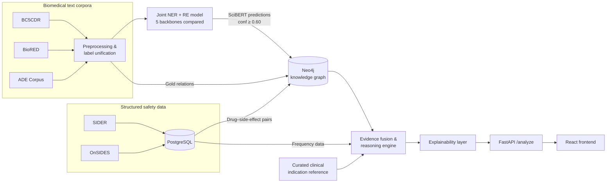
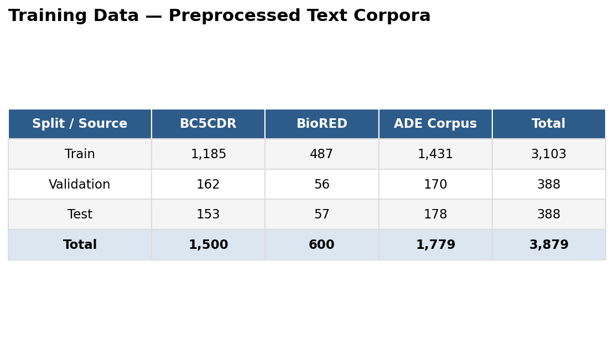
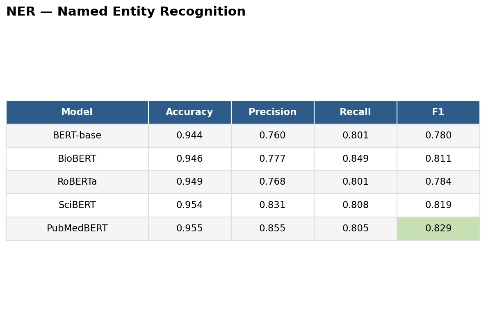
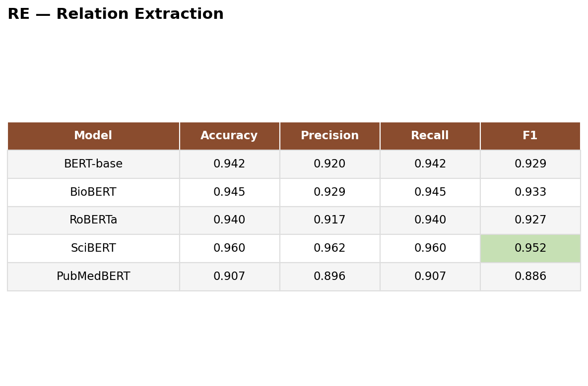
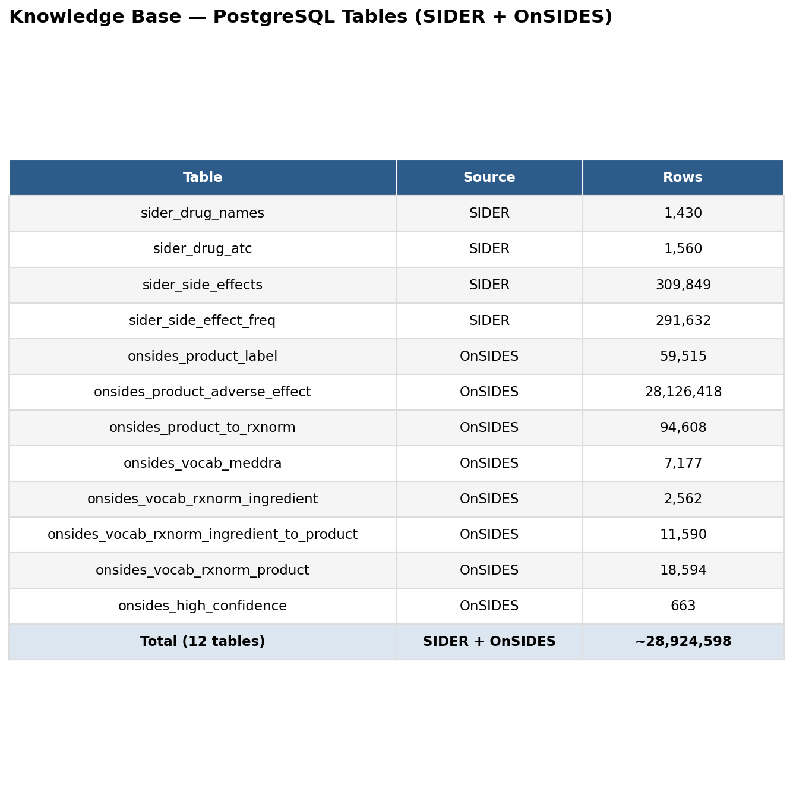
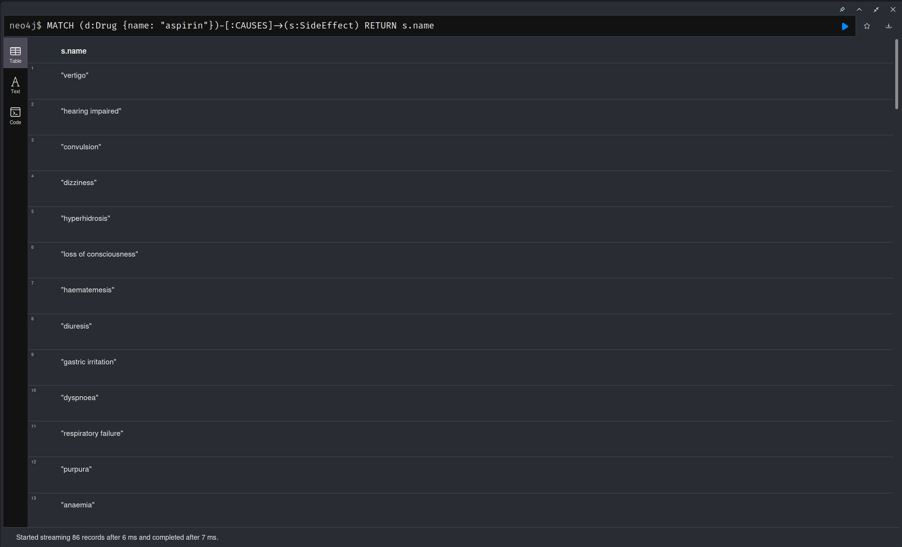

# Pharmacovigilance Advisory System

### Joint Transformer-Based Entity & Relation Extraction with Knowledge-Graph Evidence Fusion for Drug Safety

An end-to-end pharmacovigilance system that extracts drug–disease and drug–adverse-event relationships from biomedical literature, fuses them with curated drug-safety databases in a graph knowledge base, and serves explainable suitability verdicts, ranked side-effect profiles and safer alternatives through a web interface.


---

## Table of Contents

1. [Overview](#1-overview)
2. [Key Results](#2-key-results)
3. [System Architecture](#3-system-architecture)
4. [Datasets](#4-datasets)
5. [Joint NER + RE Model](#5-joint-ner--re-model)
6. [Experimental Results](#6-experimental-results)
7. [Knowledge Base & Knowledge Graph](#7-knowledge-base--knowledge-graph)
8. [Reasoning & Explainability Layer](#8-reasoning--explainability-layer)
9. [Backend API](#9-backend-api)
10. [Frontend](#10-frontend)
11. [Repository Structure](#11-repository-structure)
12. [Setup & Reproduction](#12-setup--reproduction)
13. [Limitations](#13-limitations)
14. [Future Work](#14-future-work)
15. [Disclaimer](#15-disclaimer)

---

## 1. Overview

Adverse drug reactions are a major cause of preventable harm, and much of the evidence about them is buried in unstructured biomedical text. This project automates the extraction of that evidence and connects it to structured safety data so that a user can ask a single question:

> **"Is drug _X_ suitable for condition _Y_ — and if not, what are safer alternatives?"**

The system answers it in four stages:

| Stage | What it does |
|---|---|
| **Extraction** | A shared transformer encoder is jointly fine-tuned for Named Entity Recognition (NER) and Relation Extraction (RE) on three merged biomedical corpora. Five backbones are compared under identical conditions. |
| **Knowledge fusion** | SIDER and OnSIDES (~28.9M rows) are loaded into PostgreSQL; drug–side-effect, gold-annotated drug–disease and model-predicted drug–disease relations are unified in a Neo4j knowledge graph. |
| **Reasoning** | A rule-based evidence-fusion engine combines graph evidence, SciBERT predictions, a curated clinical reference and SIDER frequency data into a suitability verdict, a severity-ranked side-effect list and alternative-drug suggestions. |
| **Explanation & delivery** | Each verdict is accompanied by its evidence source, confidence, supporting literature sentences and a factor-level score breakdown, exposed through a FastAPI service and a React interface. |

---

## 2. Key Results

| Item | Result |
|---|---|
| Best NER backbone | **PubMedBERT** — F1 **0.829**, Precision 0.855, Accuracy 0.955 |
| Highest NER recall | **BioBERT** — Recall **0.849** |
| Best RE backbone | **SciBERT** — F1 **0.952**, Precision 0.962, Recall 0.960, Accuracy 0.960 |
| Classical baseline (TF-IDF + Linear SVM) | Relation F1 **0.705**, Accuracy 0.712 (test) |
| Unified training corpus | **3,879** records (BC5CDR + BioRED + ADE), split 3,103 / 388 / 388; 52,509 entity mentions; 10,702 relations |
| Structured knowledge base | **12** source tables in PostgreSQL, **28,925,598** rows (SIDER + OnSIDES) |
| Knowledge graph | **12,714** nodes and **179,217** relationships in Neo4j |
| SciBERT-predicted relations | **15,687** drug → disease relations (confidence ≥ 0.60) added to the graph |

---

## 3. System Architecture



All backend services run as Docker containers orchestrated with Docker Compose: the NLP/API service (GPU-enabled PyTorch image), PostgreSQL 15, Neo4j 5.18 and Redis 7.

---

## 4. Datasets

### 4.1 Text corpora (for NER + RE training)

| Corpus | Content | Original relation labels |
|---|---|---|
| **BC5CDR** | PubMed abstracts annotated with chemicals, diseases and chemical-induced-disease links | `CID` |
| **BioRED** | PubMed abstracts with six entity types and multiple biomedical relation types | `Association`, `Positive_Correlation`, `Negative_Correlation`, `Bind`, `Cotreatment`, `Comparison`, `Drug_Interaction`, `Conversion` |
| **ADE Corpus** | Sentences from medical case reports annotated with drug → adverse-effect pairs | `ADVERSE` |

All three are converted to a single JSONL schema (tokens, BIO tags, entity spans, relations, source) and normalised:

- **Entity types →** `Chemical`, `Disease`, `Gene`, `Organism`, `Variant`, `CellLine`
- **Relation types →** `CAUSES` (from `CID`, `ADVERSE`), `ASSOCIATED` (all BioRED relation types), plus `NONE` for negative pairs

The merged records are shuffled (seed 42) and split 80 / 10 / 10:

<p align="center">
  
</p>

| Split | BC5CDR | BioRED | ADE | **Total** |
|---|---:|---:|---:|---:|
| Train | 1,185 | 487 | 1,431 | **3,103** |
| Validation | 162 | 56 | 170 | **388** |
| Test | 153 | 57 | 178 | **388** |
| **Total** | **1,500** | **600** | **1,779** | **3,879** |

Average record length is about 149 tokens.

**Entity mentions per split**

| Entity type | Train | Validation | Test | **Total** |
|---|---:|---:|---:|---:|
| Chemical | 17,582 | 2,179 | 2,362 | **22,123** |
| Disease | 16,026 | 2,068 | 1,847 | **19,941** |
| Gene | 5,496 | 600 | 601 | **6,697** |
| Organism | 1,811 | 181 | 200 | **2,192** |
| Variant | 1,155 | 106 | 120 | **1,381** |
| CellLine | 163 | 7 | 5 | **175** |
| **Total** | **42,233** | **5,141** | **5,135** | **52,509** |

**Annotated relations per split**

| Relation | Train | Validation | Test | **Total** |
|---|---:|---:|---:|---:|
| ASSOCIATED | 4,783 | 581 | 571 | **5,935** |
| CAUSES | 3,823 | 458 | 486 | **4,767** |
| **Total** | **8,606** | **1,039** | **1,057** | **10,702** |

**Label space**
- **NER (13 BIO tags):** `O`, plus `B-` / `I-` for `Chemical`, `Disease`, `Gene`, `Organism`, `Variant`, `CellLine`
- **RE (3 classes):** `NONE`, `ASSOCIATED`, `CAUSES`

### 4.2 Structured drug-safety data (for the knowledge base)

| Source | Used for |
|---|---|
| **SIDER** | Drug names, ATC codes, drug → side-effect pairs, side-effect frequencies |
| **OnSIDES** | Product labels, label-extracted adverse effects, RxNorm/MedDRA vocabularies (loaded into the knowledge base) |

---

## 5. Joint NER + RE Model

A single transformer encoder is shared by two task heads, so entity recognition and relation classification are learned from the same contextual representations instead of running as disconnected pipeline stages.

```
                Input tokens
                     │
          ┌──────────▼──────────┐
          │ Transformer encoder │   (BERT / RoBERTa / SciBERT / PubMedBERT / BioBERT)
          └──────────┬──────────┘
                     │ contextual embeddings + dropout
         ┌───────────┴────────────┐
         ▼                        ▼
   NER head                  RE head
   first-subword pooling     [ mean(entity₁) ; mean(entity₂) ; CLS ]
   → Linear → CRF            → Linear → ReLU → Dropout → Linear
   → BIO tags                → { NONE, CAUSES, ASSOCIATED }
```

| Component | Detail |
|---|---|
| NER head | Linear emission layer over the first sub-word of each word, decoded with a **Conditional Random Field** (`pytorch-crf`) |
| RE head | Concatenation of mean-pooled entity-span embeddings and the `[CLS]` vector, passed through a 2-layer MLP |
| Candidate pairs | All annotated relations plus sampled negative entity pairs, up to 15 pairs per example |
| Loss | `L = L_NER (CRF negative log-likelihood) + λ · L_RE (cross-entropy)`, λ = 1.0 |
| Optimiser | AdamW, learning rate 2e-5 |
| Training defaults | 3 epochs, batch size 8, max sequence length 256 |

### Backbones compared

All five models share the identical architecture, data and training procedure, so **pretraining domain is the only variable**:

| Backbone | Pretraining domain | Role in the comparison |
|---|---|---|
| **BERT-base** | General (Wikipedia, BookCorpus) | General-domain baseline |
| **RoBERTa** | General, larger corpus and improved recipe | Stronger general-domain baseline |
| **SciBERT** | Scientific literature (broad) | Partial domain shift |
| **BioBERT** | BERT continued-pretrained on PubMed + PMC | General + biomedical |
| **PubMedBERT** | Biomedical text only, trained from scratch | Fully in-domain |

A classical **TF-IDF + Linear SVM** sentence-level relation classifier (`scripts/train_tfidf_svm.py`) is also included as a non-neural baseline for the relation task.

---

## 6. Experimental Results

All results are on the held-out **test split (388 records)**.

**Evaluation protocol**
- **NER** — precision, recall and F1 are entity-level (`seqeval`); accuracy is token-level.
- **RE** — relation classification over candidate entity pairs built from gold entity spans (including sampled `NONE` pairs); precision, recall and F1 are support-weighted averages across classes.

### 6.1 Named Entity Recognition

<p align="center">
  
</p>

| Model | Accuracy | Precision | Recall | F1 |
|---|---:|---:|---:|---:|
| BERT-base | 0.944 | 0.760 | 0.801 | 0.780 |
| RoBERTa | 0.949 | 0.768 | 0.801 | 0.784 |
| BioBERT | 0.946 | 0.777 | **0.849** | 0.811 |
| SciBERT | 0.954 | 0.831 | 0.808 | 0.819 |
| **PubMedBERT** | **0.955** | **0.855** | 0.805 | **0.829** |

**Observations**
- **Domain-specific pretraining helps entity recognition.** All three scientific/biomedical models beat both general-domain models, by 3.1–4.9 F1 points over BERT-base.
- **PubMedBERT** gives the best overall NER F1 and the highest precision, so its entity boundaries are the most reliable.
- **BioBERT** has the highest recall (0.849), so it misses the fewest entities, which matters for safety applications where a missed adverse event is costly.
- RoBERTa's larger general-domain pretraining gives only a marginal gain over BERT-base (+0.004 F1), suggesting that domain matters more than pretraining scale for this task.

### 6.2 Relation Extraction

<p align="center">
  
</p>

| Model | Accuracy | Precision | Recall | F1 |
|---|---:|---:|---:|---:|
| BERT-base | 0.942 | 0.920 | 0.942 | 0.929 |
| RoBERTa | 0.940 | 0.917 | 0.940 | 0.927 |
| BioBERT | 0.945 | 0.929 | 0.945 | 0.933 |
| **SciBERT** | **0.960** | **0.962** | **0.960** | **0.952** |
| PubMedBERT | 0.907 | 0.896 | 0.907 | 0.886 |

**Observations**
- **SciBERT** leads on every RE metric (F1 0.952).
- PubMedBERT, the strongest NER model, is the weakest for RE (F1 0.886). The best backbone for entity recognition is therefore not necessarily the best for relation classification under a shared-encoder setup.
- BERT-base, RoBERTa and BioBERT perform within 0.006 F1 of each other on RE.
- RE recall equals accuracy for every model. This is expected: support-weighted recall is mathematically identical to accuracy.

### 6.3 Classical baseline — TF-IDF + Linear SVM

A non-neural baseline classifies the relation type from the sentence text alone, using TF-IDF uni- and bi-grams (10,000 features) and a class-balanced Linear SVM. Each record is replicated once per annotated relation; records with entities but no relations are labelled `NONE`.

| Split | Examples | Accuracy | Weighted F1 | Macro F1 |
|---|---:|---:|---:|---:|
| Validation | 1,042 | 0.800 | 0.800 | 0.53 |
| Test | 1,060 | **0.712** | **0.705** | 0.47 |

Per-class results on the test split:

| Class | Precision | Recall | F1 | Support |
|---|---:|---:|---:|---:|
| ASSOCIATED | 0.88 | 0.55 | 0.67 | 571 |
| CAUSES | 0.63 | 0.91 | 0.75 | 486 |
| NONE | 0.00 | 0.00 | 0.00 | 3 |

The joint transformer models improve relation F1 from **0.705** to between **0.886** (PubMedBERT) and **0.952** (SciBERT). The comparison is indicative rather than strictly like-for-like. The baseline sees only bag-of-words sentence features with no entity positions, while the transformer RE head classifies individual entity pairs. The baseline's macro F1 is pulled down by the near-empty `NONE` class (3 test examples).

### 6.4 Model selection

| Task | Selected model | Reason |
|---|---|---|
| Relation extraction (deployed in the pipeline) | **SciBERT** | Best RE F1. Its predictions populate the `MODEL_PREDICTED` edges in the knowledge graph. |
| Entity recognition | PubMedBERT (best F1) / BioBERT (best recall) | Reported for comparison. The deployed pipeline uses annotated entity spans from the corpora. |

---

## 7. Knowledge Base & Knowledge Graph

### 7.1 PostgreSQL knowledge base

SIDER and OnSIDES files are bulk-loaded with `COPY` into 12 relational tables, with indexes on the join keys used by the scoring engine.

<p align="center">
  
</p>

| Table | Source | Rows |
|---|---|---:|
| `sider_drug_names` | SIDER | 1,430 |
| `sider_drug_atc` | SIDER | 1,560 |
| `sider_side_effects` | SIDER | 309,849 |
| `sider_side_effect_freq` | SIDER | 291,632 |
| `onsides_product_label` | OnSIDES | 59,515 |
| `onsides_product_adverse_effect` | OnSIDES | 28,126,418 |
| `onsides_product_to_rxnorm` | OnSIDES | 94,608 |
| `onsides_vocab_meddra` | OnSIDES | 7,177 |
| `onsides_vocab_rxnorm_ingredient` | OnSIDES | 2,562 |
| `onsides_vocab_rxnorm_ingredient_to_product` | OnSIDES | 11,590 |
| `onsides_vocab_rxnorm_product` | OnSIDES | 18,594 |
| `onsides_high_confidence` | OnSIDES | 663 |
| **Total (12 tables)** | | **28,925,598** |

A cleaned, de-duplicated view, `drug_side_effects_clean`, joins SIDER side effects to drug names (lowercased and trimmed) and is the source for the graph migration.

### 7.2 Neo4j knowledge graph

**Schema**

| Element | Description | Source |
|---|---|---|
| `(:Drug {name})` | Drug / chemical entity | SIDER, text corpora |
| `(:SideEffect {name})` | Adverse effect | SIDER |
| `(:Disease {name})` | Disease / condition | Text corpora |
| `(Drug)-[:CAUSES]->(SideEffect)` | Known side effect | SIDER (158,095 edges) |
| `(Drug)-[:CAUSES_CONDITION]->(Disease)` | Gold-annotated causal / adverse relation | BC5CDR, ADE, BioRED |
| `(Drug)-[:ASSOCIATED_WITH]->(Disease)` | Gold-annotated association | BioRED |
| `(Drug)-[:MODEL_PREDICTED {relation, confidence, model}]->(Disease)` | Relation predicted by SciBERT (confidence ≥ 0.60) | SciBERT RE head |

**Graph statistics**

| Nodes | Count |
|---|---:|
| `SideEffect` | 6,123 |
| `Disease` | 3,567 |
| `Drug` | 3,024 |
| **Total** | **12,714** |

| Relationship | Count | Notes |
|---|---:|---|
| `CAUSES` (Drug → SideEffect) | 158,095 | From SIDER |
| `MODEL_PREDICTED` (Drug → Disease) | 15,687 | 15,596 `CAUSES` (mean confidence 0.872) and 91 `ASSOCIATED` (mean confidence 0.681) |
| `CAUSES_CONDITION` (Drug → Disease) | 4,281 | Gold annotations |
| `ASSOCIATED_WITH` (Drug → Disease) | 1,154 | Gold annotations |
| **Total** | **179,217** | |

The 5,435 gold drug–disease edges are the unique (drug, disease, relation) triples extracted from all three corpora.

Uniqueness constraints are defined on `Drug.name`, `SideEffect.name` and `Disease.name`. Data is migrated in batches of 5,000 (side effects) and 2,000 (disease relations) per transaction.

**Verification.** The graph was validated by querying individual drugs. For example, aspirin returns 86 distinct side effects, including vertigo, dizziness, haematemesis and respiratory failure.

<p align="center">
  
</p>

---

## 8. Reasoning & Explainability Layer

### 8.1 Suitability verdict (`models/suitability.py`)

Evidence is evaluated in a fixed priority order, and the first matching rule decides the verdict:

| Priority | Evidence | Verdict | Source label |
|:-:|---|---|---|
| 1 | Drug is a well-established treatment in the curated clinical reference | `LIKELY_SUITABLE` | Clinical reference |
| 2 | Drug, disease and model prediction are all absent from the knowledge base | `UNKNOWN_DRUG` / `UNKNOWN_DISEASE` | — |
| 3 | Gold `CAUSES_CONDITION` edge | `NOT_RECOMMENDED` | Human-verified annotation |
| 4 | SciBERT predicts `CAUSES` | `NOT_RECOMMENDED` | Model prediction (with confidence) |
| 5 | Gold `ASSOCIATED_WITH` edge | `LIKELY_SUITABLE` | Human-verified annotation |
| 6 | SciBERT predicts `ASSOCIATED` | `LIKELY_SUITABLE` | Model prediction (with confidence) |
| 7 | None of the above | `NO_DIRECT_EVIDENCE` | — |

**Curated clinical reference (`models/common_indications.py`).** The training corpora are adverse-event focused and contain no genuine *treats* relation. Without a correction, common drugs can be flagged as harmful for the very condition they treat. A small curated reference of 21 well-established drug–indication pairs (e.g. metformin → type 2 diabetes, albuterol → asthma) addresses this known limitation.

### 8.2 Side-effect severity ranking (`models/severity_scoring.py`, `models/ranking_engine.py`)

Side effects are retrieved from SIDER and bucketed by their reported upper-bound frequency:

| Bucket | Frequency | Weight |
|---|---|:-:|
| Common | ≥ 10% | 3 |
| Occasional | 1% – 10% | 2 |
| Rare | > 0% – 1% | 1 |
| Unknown | No frequency data | 0 |

Drugs without frequency data fall back to the unranked SIDER side-effect list. Each entry also records whether it is confirmed in the knowledge graph.

### 8.3 Alternative-drug suggestion (`models/alternative_drugs.py`)

Triggered when the verdict is `NOT_RECOMMENDED` or `NO_DIRECT_EVIDENCE`:

1. Collect candidates for the disease from the curated reference, gold `ASSOCIATED_WITH` edges and SciBERT `ASSOCIATED` predictions.
2. Exclude the queried drug and any drug with a `CAUSES_CONDITION` edge to the same disease.
3. Keep only candidates verifiable as real drugs in SIDER. This filters out hormones, metabolites and other chemicals that only co-occur in the literature.
4. Rank by side-effect burden (fewest known side effects first) and return the top 5 with their evidence source.

### 8.4 Explainability (`models/evidence_retrieval.py`, `models/score_breakdown.py`, `models/explanation_generator.py`)

| Component | Output |
|---|---|
| **Evidence retrieval** | Up to 3 source sentences from the annotated corpora that contain the drug–disease pair, with relation type and dataset of origin |
| **Score breakdown** | The verdict decomposed into weighted factors (direct evidence, side-effect burden, supporting literature), each tagged positive / negative / neutral / informational |
| **Explanation generator** | A plain-language summary combining the verdict, the contributing factors and the cited evidence |
| **Source transparency** | Every verdict states whether it comes from the clinical reference, a human-verified annotation or a SciBERT prediction (with confidence) |

---

## 9. Backend API

FastAPI service (`api/main.py`), CORS-enabled for the React client.

| Method | Endpoint | Description |
|---|---|---|
| `GET` | `/health` | Service health check |
| `POST` | `/analyze` | Full analysis for a drug–disease pair |

**Request**

```json
{ "drug": "metformin", "disease": "type 2 diabetes" }
```

**Response fields**

| Field | Description |
|---|---|
| `suitability` | `verdict`, `reason`, `source`, `side_effect_count`, `common_side_effect_count`, `has_side_effect_data` |
| `score_breakdown` | List of `{factor, impact, weight, detail}` |
| `evidence_sentences` | List of `{sentence, relation_type, source_dataset, doc_id}` |
| `explanation` | Natural-language explanation |
| `side_effects` | Top 15 ranked side effects with frequency, severity bucket and graph confirmation |
| `total_side_effects` | Total number of known side effects |
| `alternatives` | Ranked alternative drugs with side-effect count and source, or `null` when not required |

Interactive API documentation is available at `http://localhost:8000/docs` while the server is running.

---

## 10. Frontend

A single-page React application (`frontend/`) for the advisory workflow:

- Drug and disease input with one-click example queries
- **Colour-coded verdict card** (Likely Suitable / Not Recommended / No Direct Evidence / Unknown)
- **Source badge** distinguishing *Clinical Reference*, *Human-Verified* annotations and *SciBERT Prediction*, with a confidence bar for model predictions
- Known side effects of the queried drug
- Suggested alternatives with side-effect counts and evidence source
- Supporting literature sentences with dataset and relation type
- Explanatory empty states that say *why* no data or alternatives are shown
- Collapsible "How does this system work?" panel describing the pipeline

---

## 11. Repository Structure

```
pharmacovigilance/
├── api/
│   └── main.py                         # FastAPI app: /health, /analyze
├── models/
│   ├── joint_model.py                  # Shared encoder + CRF NER head + MLP RE head
│   ├── dataset.py                      # Dataset, sub-word alignment, negative-pair sampling
│   ├── kg_query.py                     # Neo4j query client
│   ├── kb_utils.py                     # SIDER drug lookup
│   ├── severity_scoring.py             # SIDER frequency-based severity buckets
│   ├── ranking_engine.py               # Severity-ranked side effects
│   ├── suitability.py                  # Evidence-fusion verdict logic
│   ├── common_indications.py           # Curated drug–indication reference
│   ├── alternative_drugs.py            # Alternative-drug suggestion
│   ├── evidence_retrieval.py           # Literature evidence sentences
│   ├── score_breakdown.py              # Factor-level score decomposition
│   ├── explanation_generator.py        # Natural-language explanation
│   └── analyze_drug_disease.py         # End-to-end analysis entry point
├── scripts/
│   ├── preprocessing_utils.py          # Tokenisation and BIO tagging helpers
│   ├── preprocess_bc5cdr.py            # BC5CDR → unified JSONL
│   ├── preprocess_biored.py            # BioRED → unified JSONL
│   ├── preprocess_ade.py               # ADE Corpus → unified JSONL
│   ├── merge_datasets.py               # Label normalisation + 80/10/10 split
│   ├── build_label_maps.py             # NER / RE label ↔ id maps
│   ├── sanity_check.py                 # Split statistics and integrity checks
│   ├── train_tfidf_svm.py              # Classical baseline
│   ├── smoke_test.py                   # 1-epoch end-to-end training check
│   ├── train_joint_model.py            # Joint model training
│   ├── evaluate_model.py               # Test-set evaluation → comparison CSV
│   ├── generate_metrics_images.py      # Comparison tables and charts
│   ├── load_kb_postgres.py             # SIDER + OnSIDES → PostgreSQL
│   ├── build_kb_schema.py              # Cleaned drug–side-effect table
│   ├── setup_neo4j_schema.py           # Neo4j uniqueness constraints
│   ├── migrate_to_neo4j.py             # Drug → SideEffect graph migration
│   ├── extract_disease_associations.py # Gold drug–disease pairs from corpora
│   ├── load_disease_associations.py    # Gold pairs → Neo4j
│   ├── generate_model_predictions.py   # SciBERT relation predictions
│   └── load_model_predictions_to_neo4j.py
├── frontend/                           # React application
├── screenshots/                        # Neo4j verification screenshots
├── comparison_table_ner.png
├── comparison_table_re.png
├── training_data_table.png
├── knowledge_base_table.png
├── Dockerfile
└── docker-compose.yml
```

---

## 12. Setup & Reproduction

### 12.1 Prerequisites

- Docker and Docker Compose
- NVIDIA GPU with the NVIDIA Container Toolkit (for training; inference also runs on CPU)
- Node.js 18+ and npm (for the frontend)

### 12.2 Data

Datasets and checkpoints are not committed to the repository. Download them and place them as follows:

```
data/raw/
├── bc5cdr/            # BC5CDR PubTator .txt files (train / dev / test)
├── biored/            # BioRED PubTator files
├── ade_corpus/        # DRUG-AE.rel
├── sider/             # drug_names.tsv, drug_atc.tsv, meddra_all_se.tsv, meddra_freq.tsv
└── onsides/           # product_label.csv, product_adverse_effect.csv, product_to_rxnorm.csv,
                       # vocab_meddra_adverse_effect.csv, vocab_rxnorm_ingredient.csv,
                       # vocab_rxnorm_ingredient_to_product.csv, vocab_rxnorm_product.csv,
                       # high_confidence.csv
```

### 12.3 Start the services

```bash
docker compose up -d --build
docker exec -it text_analytics_nlp bash      # all following Python commands run inside this container
```

| Service | Port |
|---|---|
| FastAPI | 8000 |
| PostgreSQL | 5432 |
| Neo4j Browser / Bolt | 7474 / 7687 |
| Redis | 6379 |

> The container sets `HF_HUB_OFFLINE=1`. Pre-download the backbone models into the `hf_cache` volume, or unset the variable for the first run.

### 12.4 Preprocess and train

```bash
cd /workspace/scripts
python preprocess_bc5cdr.py
python preprocess_biored.py
python preprocess_ade.py
python merge_datasets.py
python build_label_maps.py
python sanity_check.py

python train_tfidf_svm.py                      # classical baseline
python smoke_test.py                           # quick end-to-end check

# Repeat for each backbone
python train_joint_model.py --backbone allenai/scibert_scivocab_uncased \
       --output_dir /workspace/models/checkpoints/scibert
python evaluate_model.py --backbone allenai/scibert_scivocab_uncased \
       --checkpoint /workspace/models/checkpoints/scibert/model.pt --model_name SciBERT

python generate_metrics_images.py              # comparison tables and charts
```

### 12.5 Build the knowledge base and graph

```bash
python load_kb_postgres.py
python build_kb_schema.py
python setup_neo4j_schema.py
python migrate_to_neo4j.py
python extract_disease_associations.py
python load_disease_associations.py
python generate_model_predictions.py           # requires the SciBERT checkpoint
python load_model_predictions_to_neo4j.py
```

### 12.6 Run the application

```bash
# Backend (inside the container)
cd /workspace
uvicorn api.main:app --host 0.0.0.0 --port 8000

# Frontend (on the host)
cd frontend
npm install
npm start                                      # http://localhost:3000
```

---

## 13. Limitations

- **No explicit *treats* relation in training data.** The corpora are adverse-event focused, so therapeutic relations are not learned directly. A curated reference partially compensates, but it covers only 21 drugs.
- **ADE Corpus entity offsets.** `DRUG-AE.rel` gives entity offsets relative to the full abstract, but the preprocessing applies them to the individual sentence. As a result, only 1,779 of the 6,821 ADE pairs are retained, and their token-level entity spans do not align with the annotated drug and effect. Entity *names* (used for the knowledge graph and evidence retrieval) are unaffected. Locating entities by string match within each sentence is the planned fix, followed by re-training.
- **Skew in model-predicted relations.** 99.4% of SciBERT's predicted drug–disease relations are `CAUSES` (15,596 of 15,687), about 3.6× the number of gold `CAUSES_CONDITION` edges. Verdicts based only on a model prediction should therefore be read with caution. The interface labels them as model predictions with their confidence.
- **RE is evaluated on gold entity spans.** The reported RE scores measure relation classification given correct entities, not end-to-end extraction. Weighted averaging also includes the majority `NONE` class.
- **Random record-level split.** Corpora are merged and re-split rather than using their official partitions, so the scores are not directly comparable with published benchmarks on individual datasets.
- **Exact-string entity matching.** Drug and disease names are matched after lowercasing, without ontology normalisation (e.g. MeSH, RxNorm, UMLS). Synonyms and brand names may be missed.
- **Coverage is bounded by SIDER** (~1,430 drugs) for side-effect and alternative-drug information.
- **OnSIDES is loaded but not yet used** by the reasoning engine.

---

## 14. Future Work

- Integrate OnSIDES label-derived adverse effects into severity scoring and alternative ranking
- Ontology-based entity normalisation (MeSH / RxNorm / UMLS) for synonym and brand-name handling
- End-to-end relation evaluation on predicted entities, with per-class and macro-averaged metrics
- Train with a dedicated therapeutic-relation corpus to learn *treats* relations directly
- Use ATC classes for therapeutically equivalent alternative suggestions
- Redis caching of repeated queries and connection pooling for lower latency
- Display the score breakdown and natural-language explanation in the frontend
- Containerise the frontend and add CI tests

---

## 15. Disclaimer

This system is an academic research prototype developed for a Text Analytics course project. Its outputs are generated automatically from literature and public databases and **must not be used as medical advice**. Always consult a qualified healthcare professional.
